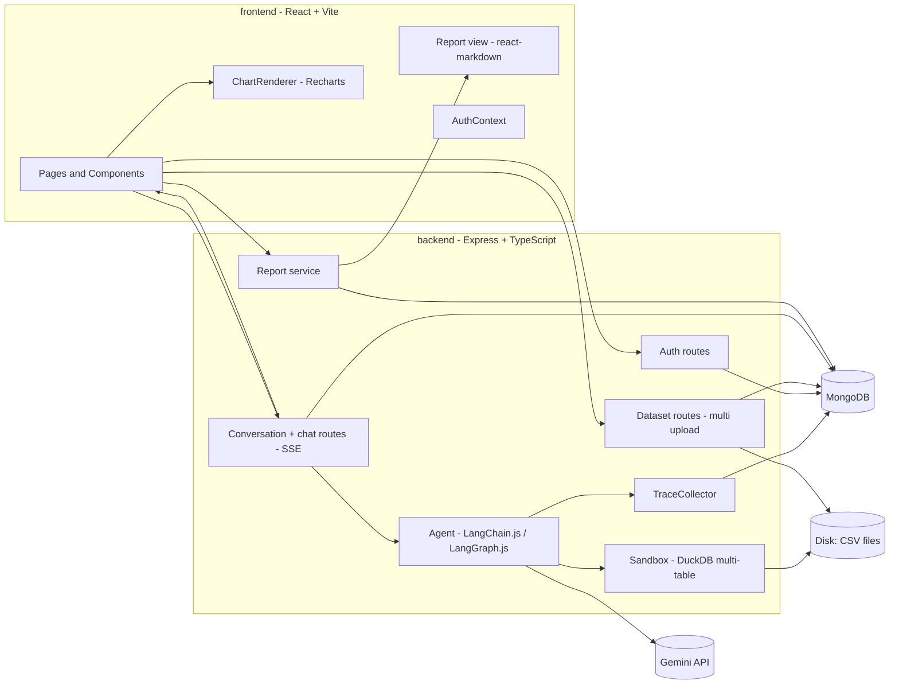

# AI Data Analyst

An intelligent data analysis web application where users can upload multiple CSV files, select datasets to analyze, ask natural language questions, and receive streaming answers with generated DuckDB SQL queries, data tables, and interactive Recharts visualizations. The platform also maintains a living, deterministic analysis report and trace for every question.

---

## Architecture Overview



---

## Tech Stack

| Layer | Choice |
|---|---|
| **Frontend** | React 19 + Vite + TypeScript, Tailwind CSS, Recharts, React Router, `react-markdown` |
| **Backend** | Node.js + Express + TypeScript |
| **Agent** | LangChain.js + LangGraph.js (`createReactAgent`), Zod schemas |
| **LLM** | Gemini API (`ChatGoogleGenerativeAI` via `@langchain/google-genai`) |
| **Analytics Engine** | DuckDB (`@duckdb/node-api`), isolated in-memory instance per question |
| **Database** | MongoDB + Mongoose (users, datasets, conversations, messages, run logs) |
| **Auth** | bcrypt (cost 12) + JWT in `httpOnly` cookie (`SameSite=Lax`) |
| **Storage** | Local disk `backend/storage/<userId>/<datasetId>.csv` |

---

## Folder Structure

```
SQLRag/
├── frontend/                         # Vite + React client app
│   ├── src/
│   │   ├── api/                      # Fetch wrappers with credentials: "include", SSE client
│   │   ├── context/                  # AuthContext
│   │   ├── components/               # Auth, datasets, chat, charts, report components
│   │   ├── pages/                    # LoginPage, RegisterPage, AppPage
│   │   └── types/                    # API and data contract TypeScript interfaces
│   ├── .env.example
│   └── vite.config.ts
├── backend/                          # Express + TypeScript API server
│   ├── src/
│   │   ├── config/                   # env.ts (Zod validation), db.ts
│   │   ├── middleware/               # requireAuth, rateLimit, errorHandler
│   │   ├── models/                   # User, Dataset, Conversation, Message, RunLog
│   │   ├── routes/                   # auth.ts, datasets.ts, conversations.ts
│   │   ├── services/                 # datasets, sandbox (DuckDB), agent (Gemini), report
│   │   ├── schemas/                  # Zod validation schemas
│   │   └── index.ts                  # App entry point
│   ├── storage/                      # Local uploaded CSV storage (gitignored)
│   ├── evals/                        # Evals question sets and runner
│   └── .env.example
└── docs/                             # task.md, design.md, flows.md, rules.md, INTERVIEW_NOTES.md
```

---

## Setup & Running Locally

For a comprehensive guide including troubleshooting and Windows-specific details, see [docs/RUN_GUIDE.md](file:///d:/Projects/SQLRag/docs/RUN_GUIDE.md).

### Prerequisites
- Node.js (v20+ recommended)
- MongoDB running locally on port 27017 (or MongoDB Atlas URI)
- Google Gemini API Key from [Google AI Studio](https://aistudio.google.com/)

### Step 1: Configure Environment Variables
- **Backend**:
  ```powershell
  cd backend
  cp .env.example .env
  # Update GOOGLE_API_KEY, JWT_SECRET, and MONGODB_URI in backend/.env
  ```
- **Frontend**:
  ```powershell
  cd frontend
  cp .env.example .env
  ```

### Step 2: Start the Backend Server (Terminal 1)
```powershell
cd backend
npm install
npm run dev
```
The backend API server will run at `http://localhost:4000`. Test the health route at `http://localhost:4000/api/health`.

### Step 3: Start the Frontend Client (Terminal 2)
```powershell
cd frontend
npm install
npm run dev
```
The frontend Vite server will run at `http://localhost:5173`. In development, requests to `/api` are automatically proxied to `http://localhost:4000`.

