# flows.md — AI Data Analyst

All flows below use Mermaid diagrams (they render on GitHub and in VS Code with a Mermaid extension) followed by a short written description.

---

## 1. Registration

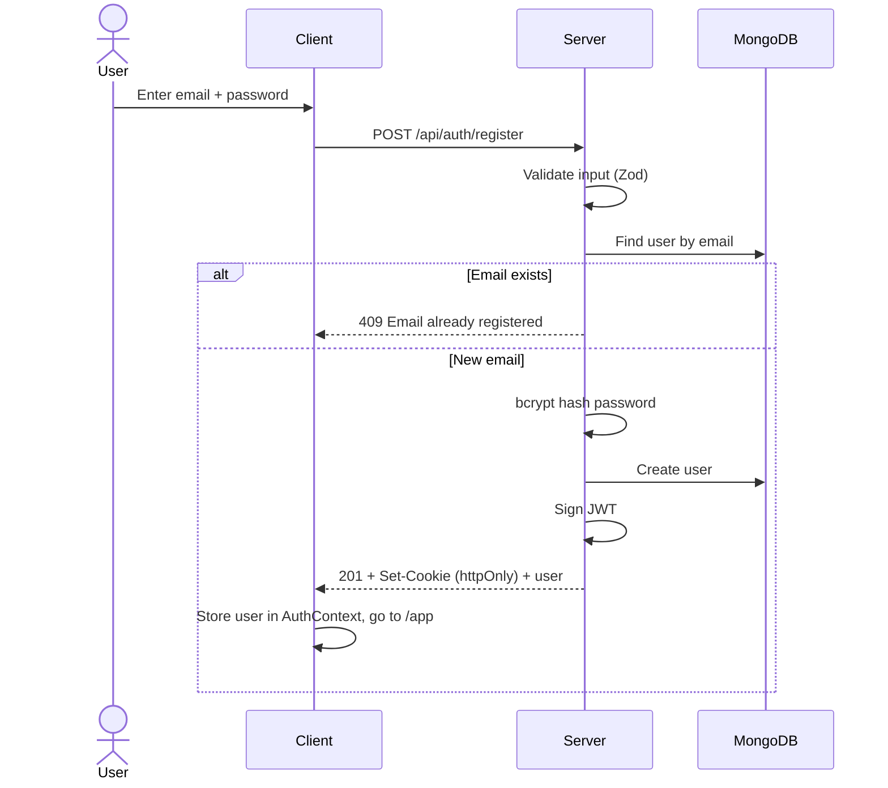

**Notes:** passwords are never stored or logged in plain text. Password rule: minimum 8 characters.

---

## 2. Login

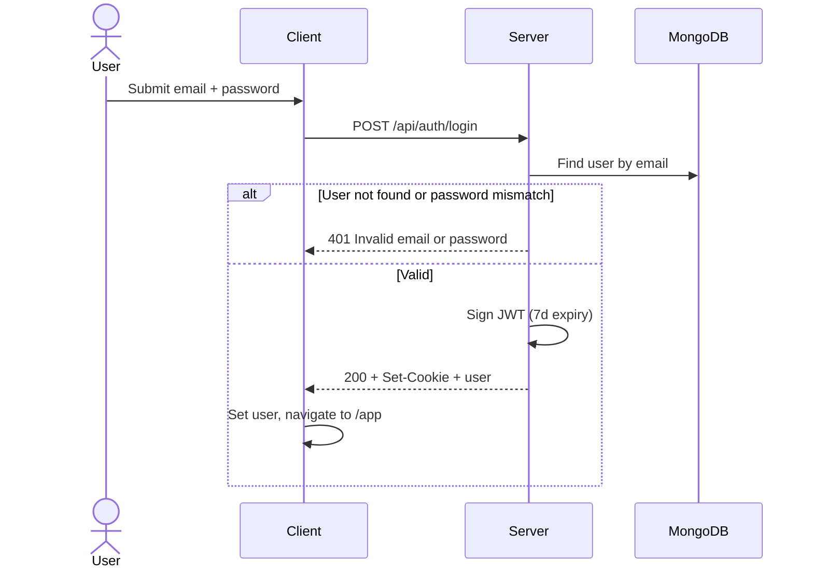

**Notes:** the error message is identical for "no such user" and "wrong password" to avoid account enumeration. The auth routes are rate limited.

---

## 3. Session restore (page refresh)

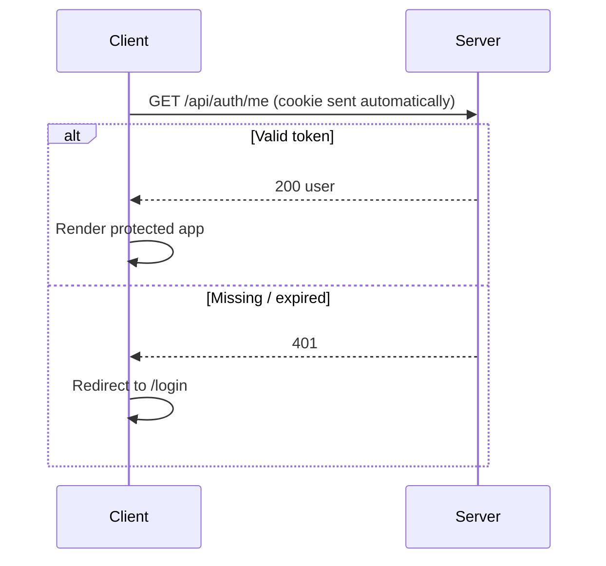

While this request is pending, the client shows a loading screen so the login page does not flash.

---

## 4. Logout

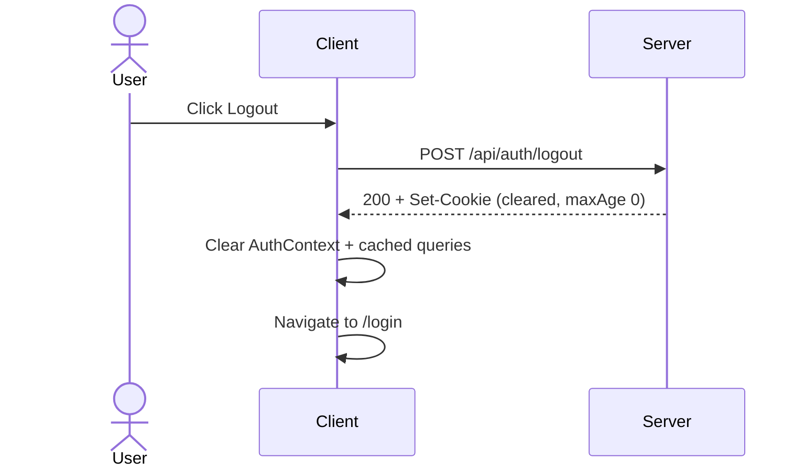

**Notes:** the client also clears any in-memory chat state so the next user on the same browser sees nothing from the previous session.

---

## 5. Upload multiple CSVs

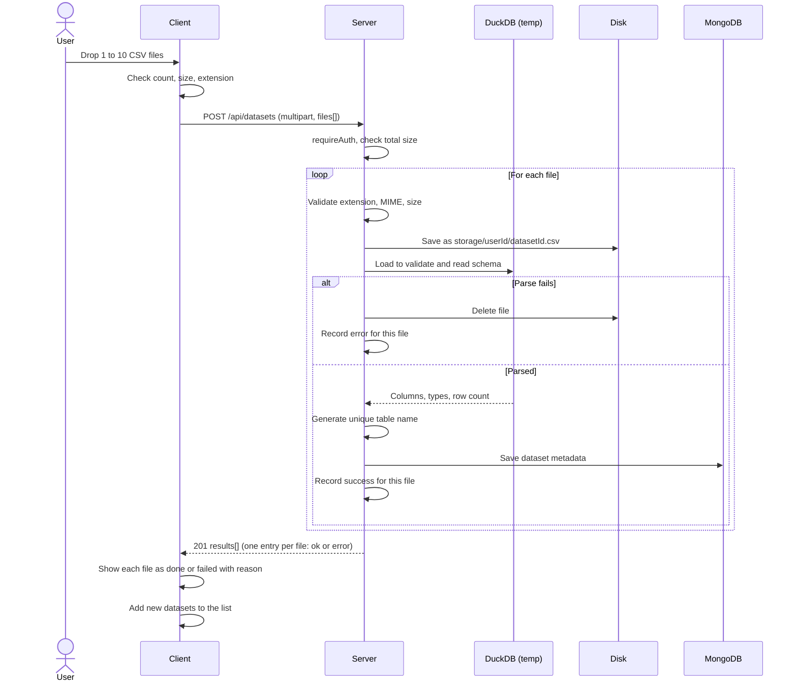

One bad file never blocks the others. The user sees exactly which files worked and why a file failed.

---

## 6. Start a conversation with selected datasets

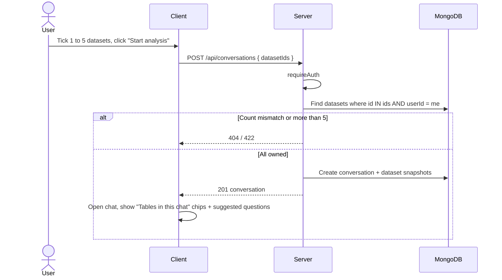

If any id is not owned by the user, the whole request fails with 404 so nothing leaks about other users' data.

---

## 7. Ask a question (main flow, multi-table, with tracing)

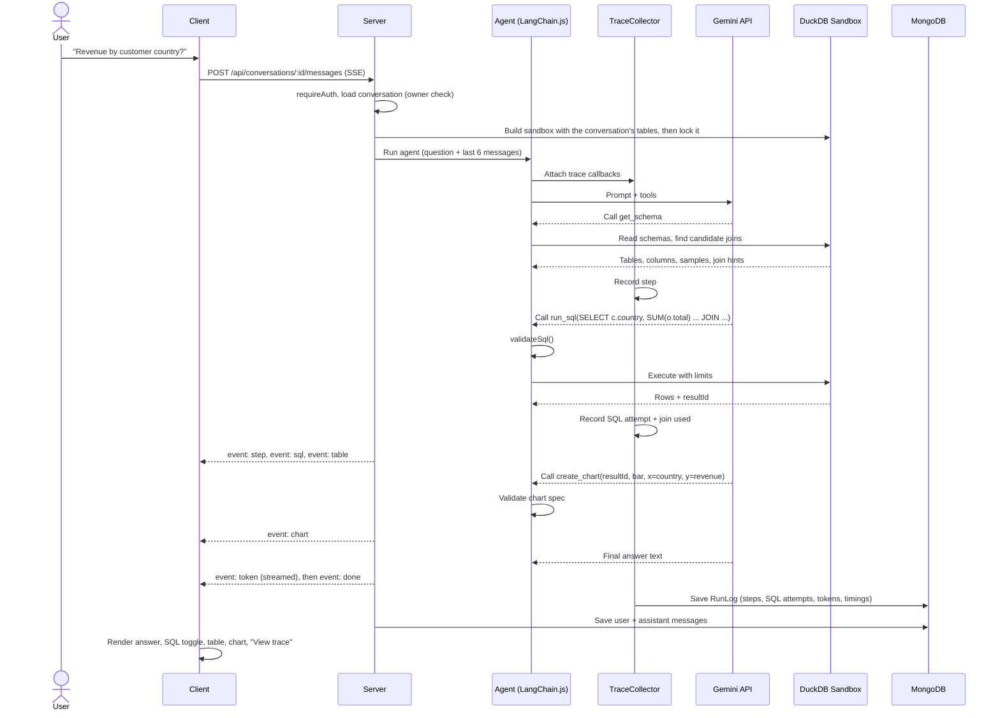

The RunLog is saved on success, failure, and abort, so the report always reflects reality.

---

## 8. SQL error and self-correction loop

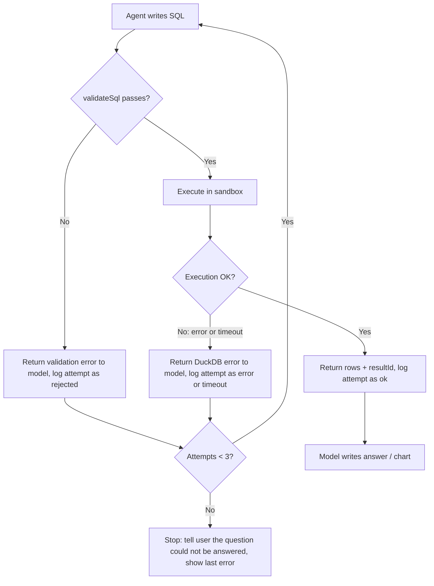

Every attempt, including the failed ones, is in the trace and appears in the report. This is useful evidence of how the agent behaves and recovers.

---

## 9. Chart rendering

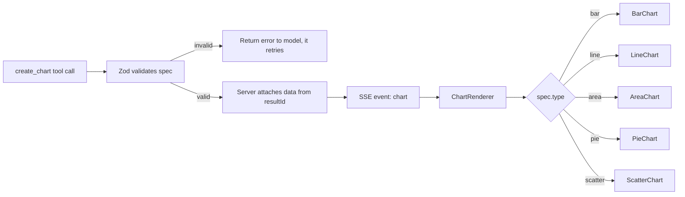

The model never copies raw data into the chart spec. It only names the `resultId` and the columns to plot, and the server attaches the rows.

---

## 10. Analysis report (living doc)

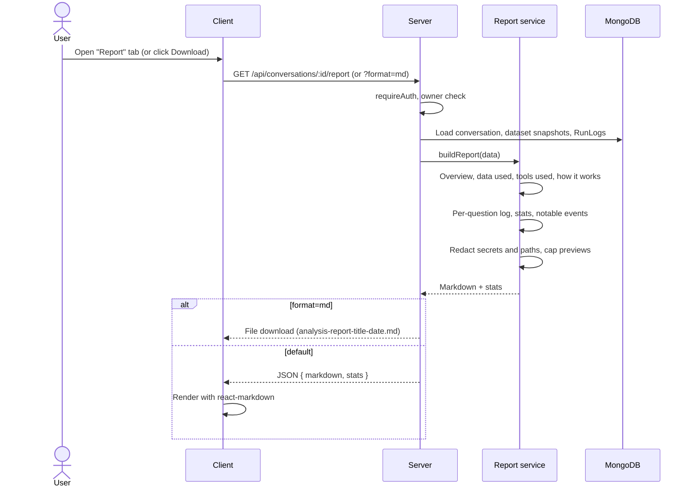

Because the report is built from stored traces each time, it is never out of date and cannot drift from what the agent really did.

---

## 11. Delete a dataset

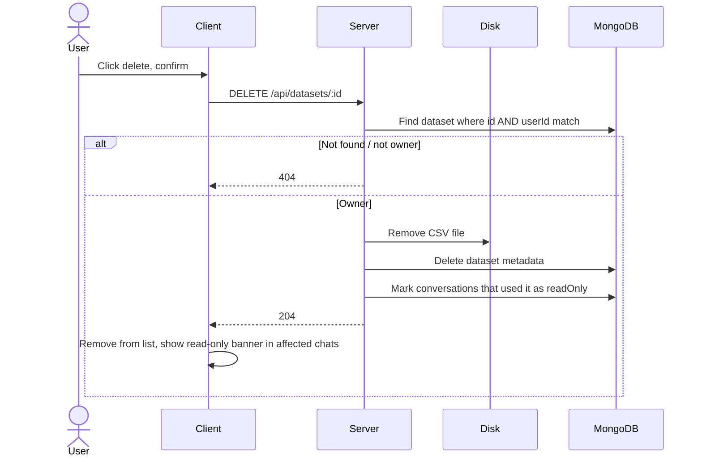

Conversations, messages, and run logs are kept (with the stored schema snapshot), so past reports still work. A 404 is returned for another user's dataset so its existence is not revealed.

---

## 12. Error states summary

| Situation | HTTP / event | What the user sees |
|---|---|---|
| Not logged in | 401 | Redirect to login |
| Wrong credentials | 401 | "Invalid email or password" |
| Too many login attempts | 429 | "Try again in a few minutes" |
| Too many files / file too large / wrong type | 413 / 415 / 422 | Per-file error in the upload list |
| One CSV in a batch cannot be parsed | 201 with an error entry | That file shows "Could not read this CSV" and the reason; others succeed |
| Dataset not yours | 404 | "Dataset not found" |
| More than 5 datasets selected | 422 | "Select up to 5 datasets" |
| Conversation is read-only | 409 | Banner: "A dataset in this chat was deleted" |
| SQL rejected or failed 3 times | SSE `error` | Friendly message + last error in an expandable section |
| Query timeout | SSE `error` | "That query took too long, try narrowing the question" |
| Gemini rate limit or outage | SSE `error` | "The AI service is busy, please retry in a moment" |
| Client stops the stream | aborted | Run saved as `aborted` in the report |
